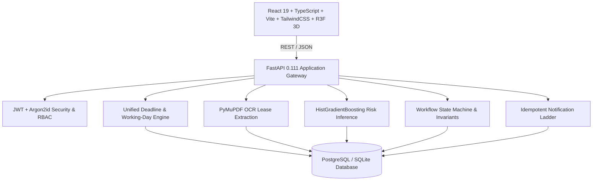

# AICTE ApproveFlow — System Architecture & Design Specification

Integrated AICTE Approval Workflow Automation, Compliance Monitoring, and Alert Management System aligned with the AICTE Regulation Bureau problem statement.

---

## 1. System Vision & Invariant Governance

AICTE ApproveFlow is an enterprise-grade full-stack regulatory management platform engineered to eliminate administrative pendency, prevent statutory SLA breaches, and enforce compliance across technical institutions throughout India.

### The Non-Negotiable Human Invariant
> **Core Rule:** Automated alerts, ML breach-risk estimates, and OCR extractions support, but **never replace**, the decisions of the Competent Authority. Under no circumstance does any automated subsystem or algorithm issue a statutory approval or rejection.

---

## 2. End-to-End Technology Stack

### Frontend Architecture
- **Framework:** React 19 + TypeScript + Vite
- **Styling:** Tailwind CSS with custom institutional design system (`#0B1B3A`, `#06122C`, `#1D4ED8`, cyan `#38BDF8`)
- **State Management:** Zustand (`useAuth`, `useUi`) + TanStack React Query v5 (cache-first data fetching & real-time refetching)
- **3D Visualization:** React Three Fiber + `@react-three/drei` + Three.js with capped DPR (1.5 max), visibility pausing (`usePauseWhenHidden`), and graceful static SVG/CSS fallbacks (`Fallback2D`)

### Backend Architecture
- **Framework:** FastAPI with Python 3.11+
- **ORM & DB:** SQLAlchemy 2.0 with PostgreSQL in production, SQLite for standalone demo
- **Security:** Passlib (Argon2id), PyJWT with token versions and email verification, SlowAPI rate-limiting
- **Document Processing:** PyMuPDF (`fitz`) for legal text parsing, regular expression candidate matchers
- **Machine Learning:** Scikit-Learn 1.9.1 HistGradientBoosting pipeline with zero data leakage

---

## 3. Four Core Statutory Pillars

### Pillar 1: Unified Deadline Engine
Manages four statutory streams through a single synchronized pipeline:
1. **Application Stage SLAs:** Working-day limits for Scrutiny (15d), EVC (15d), and SAC/SHC (30d).
2. **EVC Visit Scheduling & Report Submission:** T-minus countdowns from committee notification to on-site inspection.
3. **Institutional Undertakings:** Time-bound compliance deadlines (e.g. 30/60 days) to rectify deficiencies.
4. **Document & Land Lease Expiry:** Proactive tracking of land deeds, safety certificates, and recurring NOCs.
- Features complete pause/resume capability for statutory freezes, officer leave, and court stays.

### Pillar 2: Working-Day Calendar Engine
- Enforces 5-day or 6-day statutory working calendar per AICTE APH rules.
- Intercepts and skips weekend days and 14 gazetted Indian national holidays.
- Calculates accurate target due dates using `add_working_days` and tracks elapsed working days via `count_working_days`.

### Pillar 3: PyMuPDF OCR Lease Extraction & Human-in-the-Loop Review
- Automatically extracts commencement dates, expiry dates, lessor/lessee identities, registered premises addresses, and renewal clauses from uploaded PDF documents.
- Produces confidence scores and displays values side-by-side in an interactive review modal.
- Strictly requires an authorized officer to inspect, verify, and confirm before setting official document validity.

### Pillar 4: ML SLA Breach-Risk Prediction Engine
- Trained on 15,000 synthetic regulatory records generated without target leakage.
- Evaluates application type, stage, age, officer workload ratios, deficiency history, and calendar constraints.
- Delivers real-time breach probability, risk tier (`LOW`, `MODERATE`, `HIGH`), and the top 3 contributing factors for early decision support.

---

## 4. Role-Based Access Control (RBAC) Matrix

| Role Code | Description | Key Permissions |
|---|---|---|
| `super_admin` | Central AICTE Administrator | Full system control, account provisioning, policy configuration, audit log inspection |
| `bureau_officer` | Regulation Bureau Officer | Bureau-wide monitoring, SLA pause/resume, workload rebalancing, policy review |
| `regional_officer` | Regional AICTE Officer | Jurisdiction-bound oversight, officer assignment, document verification |
| `scrutiny_officer` | Scrutiny Committee Member | Application deficiency logging, document compliance review |
| `committee_member` | SAC / SHC Expert | Hearing review, recommendation recording |
| `evc_coordinator` | EVC Committee Lead | On-site visit scheduling, GPS geo-tag verification, report upload |
| `competent_authority` | Member Secretary / Chairman | Final statutory approval or rejection decision execution |
| `institution_user` | College Representative | Application submission, deficiency rectification, renewal uploads |

---

## 5. Security & Statutory Auditability

1. **Immutable Audit Trail:** Every workflow transition, statutory decision, deadline pause, and officer login writes an immutable `AuditLog` row with timestamp, actor ID, and IP address.
2. **Session Invalidation:** User model maintains a `token_version` column; password resets immediately increment this integer to invalidate all existing JWTs.
3. **Strict State Machine:** Applications can only transition via valid statutory workflow rules defined in `app/workflows/engine.py`. Returning without reasons or jumping stages is blocked at the database level.
