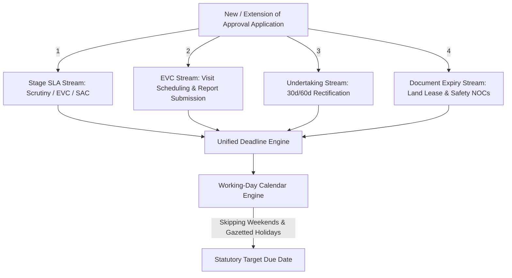

# AICTE ApproveFlow — Unified Deadline & Working-Day Calendar Engine

## 1. Executive Summary

Regulatory approval processes under the AICTE Approval Process Handbook (APH) involve multiple concurrent statutory timelines. Previously, these were tracked in disparate spreadsheets or basic calendar systems that failed to account for weekends, gazetted public holidays, or legitimate statutory pauses.

The **Unified Deadline Engine** unifies all four operational streams into a singular, highly auditable state engine.

---

## 2. Four Statutory Streams



### 1. Application Stage SLAs (`stage_sla`)
- Standard working-day limits:
  - **Scrutiny Stage:** 15 statutory working days
  - **EVC Review Stage:** 15 statutory working days
  - **SAC / SHC Hearing Stage:** 30 statutory working days
- Automatically linked to the active `application_id`. Advances or closes upon stage transition.

### 2. EVC Completion Timelines (`evc_completion`)
- Target inspection date and report submission window (typically 10 working days from expert committee constitution).
- Monitors real-time inspection completion and photo/GPS report upload.

### 3. Institutional Undertakings (`undertaking_compliance`)
- Deficiency letters issued during scrutiny or EVC grant the institution a fixed statutory window (e.g., 30 or 60 calendar/working days) to submit an affidavit or compliance certificate.
- Tracks pending compliance items and triggers automatic escalation alerts if approaching expiry.

### 4. Lease & Land Document Expiry (`document_expiry`)
- Institutional approval depends on valid land title, registered lease deeds (minimum 30 or 99 years), and building/fire safety certificates.
- Tracks statutory horizons (365d, 180d, 90d, 60d, 30d) before lease expiration to prevent unaccredited institutional operation.

---

## 3. Working-Day Calendar Engine API

Located in `backend/app/services/calendar.py`:

```python
class WorkingCalendarService:
    def is_working_day(self, check_date: date) -> bool:
        """Returns True if date is not a weekend and not a Gazetted holiday."""
        ...

    def get_next_working_day(self, start_date: date) -> date:
        """Rolls forward until the next valid working day."""
        ...

    def add_working_days(self, start_date: date, working_days: int) -> date:
        """Adds statutory working days, automatically bypassing weekends and gazetted holidays."""
        ...

    def count_working_days(self, start_date: date, end_date: date) -> int:
        """Counts only elapsed working days between two dates."""
        ...

    def calculate_due_date(self, start_date: datetime, working_days: int) -> dict:
        """Full audit breakdown returning calendar days, skipped holidays, and skipped weekends."""
        ...
```

### Gazetted Holidays 2026 Seed Data
The engine comes pre-configured with 14 national public holidays including Republic Day, Holi, Id-ul-Fitr, Independence Day, Mahatma Gandhi Jayanti, Dussehra, Diwali, and Christmas.

---

## 4. Pause and Resume Mechanics

Under statutory conditions (e.g., severe natural disasters, court stays, or designated officer deputation), the statutory clock can be paused by an authorized `super_admin` or `bureau_officer`.

### Pause Protocol
1. User invokes `POST /api/v1/deadlines/{id}/pause` specifying a mandatory `reason` (`officer_leave`, `natural_disaster`, `legal_stay`, `system_maintenance`, `other`) and `notes`.
2. Engine marks `is_paused = True` and records `paused_at = clock.now()`.
3. Background SLA jobs skip advancing the working days consumed for this deadline.

### Resume Protocol
1. User invokes `POST /api/v1/deadlines/{id}/resume`.
2. Engine computes elapsed pause duration: `pause_days = (clock.now() - paused_at).days`.
3. Engine shifts `target_due_date` forward by `pause_days` using `calendar_service.get_next_working_day`.
4. Increments `pause_accumulated_days` and clears `paused_at`.
5. Emits an immutable audit log entry documenting the statutory extension.
