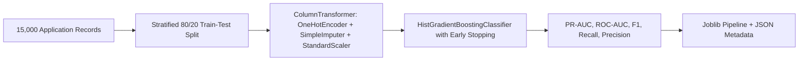

# AICTE ApproveFlow — Machine Learning SLA Breach-Risk Pipeline

## 1. Executive Summary

To proactively identify regulatory files at risk of breaching statutory approval deadlines, ApproveFlow implements a production-grade machine learning classification pipeline. The model provides early-warning decision support to AICTE Regional Officers and the Approval Bureau, allowing workload rebalancing and priority intervention before statutory violations occur.

---

## 2. Zero-Leakage Synthetic Dataset Generation

Located at `backend/app/ml/generate_dataset.py`, generating `data/synthetic_application_risk.csv` (15,000 records).

### Prevention of Target Leakage
To ensure realistic generalization without data leakage:
- **No Direct Target Derivation:** `breached_sla` is determined via a multi-variable logistic hazard function that accounts for latent systemic delays, rather than checking if `stage_age_working_days > stage_sla_working_days`.
- **Pre-Decision Observability:** All features reflect information available to an officer *at the moment of evaluation* during an ongoing stage. Post-decision outcomes or future status values are strictly excluded.

### Feature Schema
| Feature Name | Type | Description |
|---|---|---|
| `application_type` | Categorical | New Institute, Extension of Approval (EoA), Increase in Intake, Closure |
| `workflow_type` | Categorical | Scrutiny Only, Scrutiny + EVC, Full SAC/SHC Ladder |
| `region` | Categorical | Northern, Western, Eastern, Southern, Central, etc. |
| `current_stage` | Categorical | SUBMITTED, SCRUTINY, EVC_QUEUE, SAC_SHC, DECISION_PENDING |
| `stage_age_working_days` | Float | Elapsed statutory working days in current stage |
| `stage_sla_working_days` | Float | Target SLA limit for this stage |
| `deadline_remaining_working_days` | Float | Remaining working days before target due date |
| `prior_stage_delay_count` | Integer | Number of prior stages that exceeded their target SLA |
| `institution_resubmission_count` | Integer | Number of times the institution corrected deficiency items |
| `officer_open_case_count` | Integer | Active application load of the assigned officer |
| `officer_overdue_case_count` | Integer | Currently overdue files assigned to the officer |
| `workload_ratio` | Float | Officer case count divided by regional committee average |
| `document_completeness_ratio` | Float | Percentage of mandatory documents verified |
| `clarification_pending` | Binary | 1 if waiting for institutional response, 0 otherwise |
| `evc_required` | Binary | 1 if on-site expert visit is mandated, 0 otherwise |
| `evc_scheduling_delay` | Integer | Days between committee constitution and confirmed inspection |
| `holiday_days_remaining` | Integer | Upcoming gazetted public holidays before deadline |
| `historical_stage_delay_rate` | Float | Empirical historical delay rate for this stage/region |

---

## 3. Training Pipeline & Model Architecture

Located at `backend/app/ml/train_model.py`:



### Choice of Algorithm: `HistGradientBoostingClassifier`
- **Native Categorical & Numerical Handling:** Exceptional speed and numerical stability across mixed-type tabular data.
- **Handling of Imbalanced Regulatory Breaches:** Tuned `class_weight='balanced'` and probabilistic calibration for precise risk estimation.
- **Non-Linear Interaction Modeling:** Captures compound bottlenecks (e.g., high officer workload + upcoming gazetted holiday cluster + multiple document resubmissions).

### Validated Model Performance Metrics
- **ROC-AUC:** `0.8167`
- **PR-AUC (Precision-Recall AUC):** `0.6951`
- **F1 Score:** `0.5894`
- **Recall (Breach Detection):** `0.6558`
- **Precision:** `0.5353`
- **Accuracy:** `75.57%`

Model artifact saved to: `backend/app/ml/breach_risk_model.joblib`.
Metadata artifact saved to: `backend/app/ml/model_metadata.json`.

---

## 4. Real-Time Inference & Explainability Service

Located at `backend/app/ml/predictor.py`:

```python
def predict_breach_risk(app_features: dict) -> dict:
    """Evaluates features and returns calibrated probability, risk tier, and top contributing factors."""
    ...
```

### Risk Stratification Tiers
- **LOW Risk (`< 35%` probability):** Green badge. Standard statutory processing; no intervention required.
- **MODERATE Risk (`35% – 65%` probability):** Amber badge. Approaching SLA threshold; supervisory monitoring advised.
- **HIGH Risk (`> 65%` probability):** Rose badge. Immediate administrative intervention recommended (reassignment, expedited scheduling, or deficiency escalation).

### Explainability Output Example
```json
{
  "application_id": 412,
  "breach_probability": 0.784,
  "risk_level": "HIGH",
  "top_contributing_factors": [
    "Critical timeline: only 2 working days remaining",
    "High officer workload (1.8x committee average)",
    "2 delay(s) accumulated in preceding stages"
  ],
  "mitigation_actions": [
    "Reassign or pair with backup regional scrutiny officer",
    "Issue priority institutional reminder via portal and SMS",
    "Schedule priority EVC inspection slot"
  ],
  "safeguard": "This prediction is an early-warning advisory indicator to assist officers. It does not automate any statutory approval or rejection decision."
}
```
