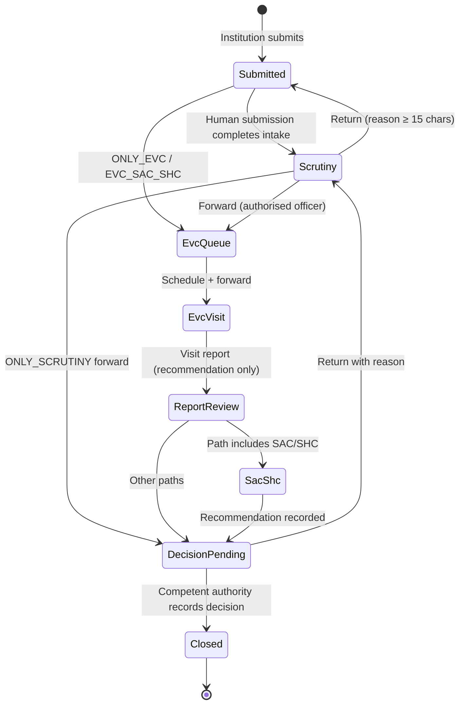

# Workflow routing engine

Simulated demo. Humans make every statutory decision. The engine only routes, validates and records.

## Templates

| Code | Path |
|---|---|
| ONLY_SCRUTINY | Submitted → Scrutiny → Decision Pending → Closed |
| SCRUTINY_EVC | Submitted → Scrutiny → EVC Queue → EVC Visit → EVC Report Review → Decision Pending → Closed |
| EVC_SAC_SHC | Submitted → EVC Queue → EVC Visit → EVC Report Review → SAC/SHC → Decision Pending → Closed |
| ONLY_EVC | Submitted → EVC Queue → EVC Visit → EVC Report Review → Decision Pending → Closed |
| SCRUTINY_EVC_SAC_SHC | Submitted → Scrutiny → EVC Queue → EVC Visit → EVC Report Review → SAC/SHC → Decision Pending → Closed |

Illegal transitions raise `IllegalTransitionError` (HTTP 409). Decision Pending cannot be forwarded; `record_decision` is the only close path and never computes approve/reject.
